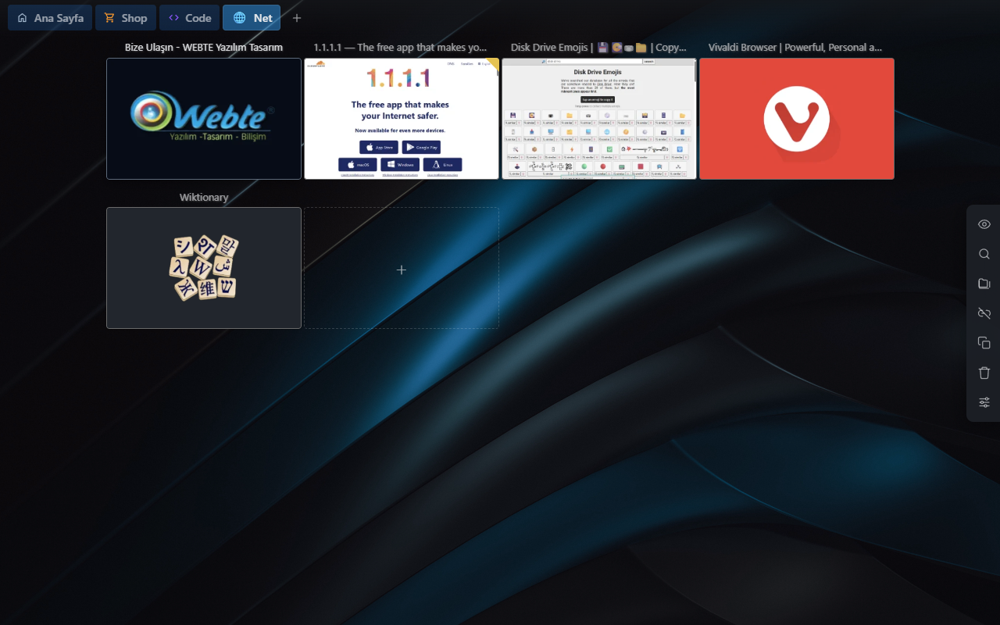
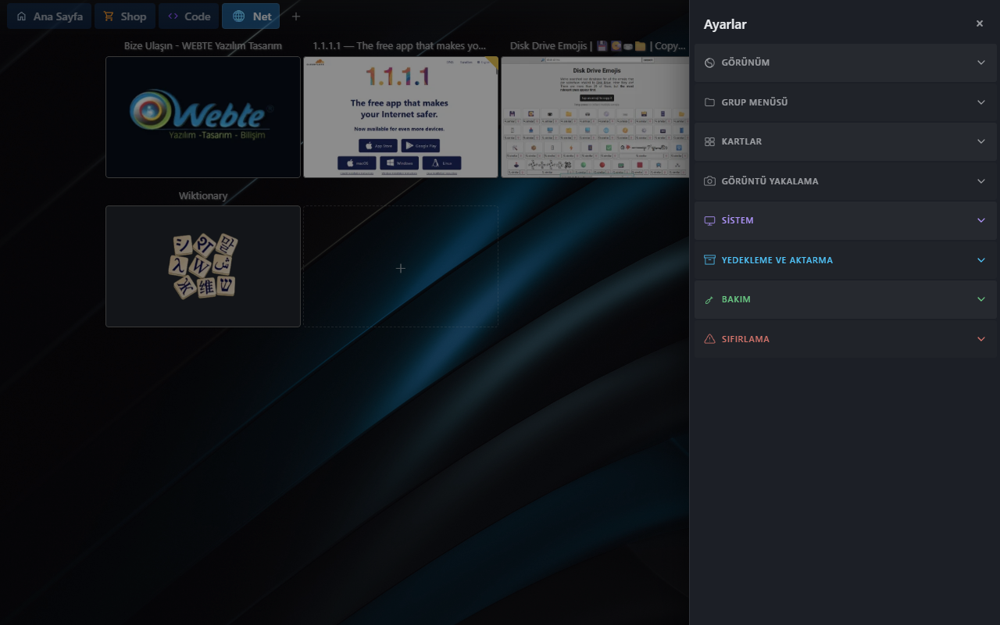
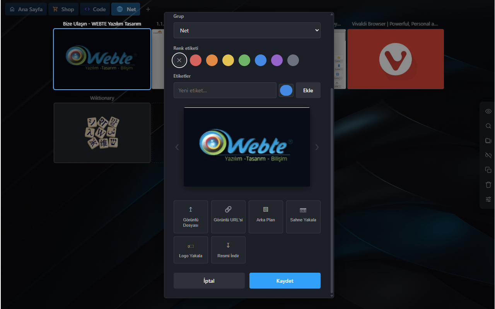
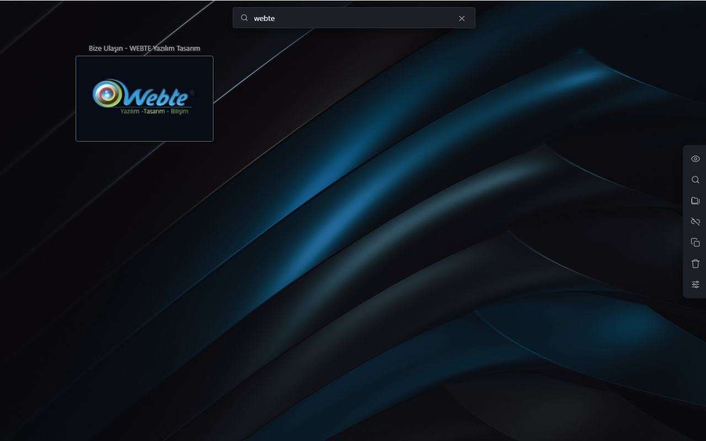
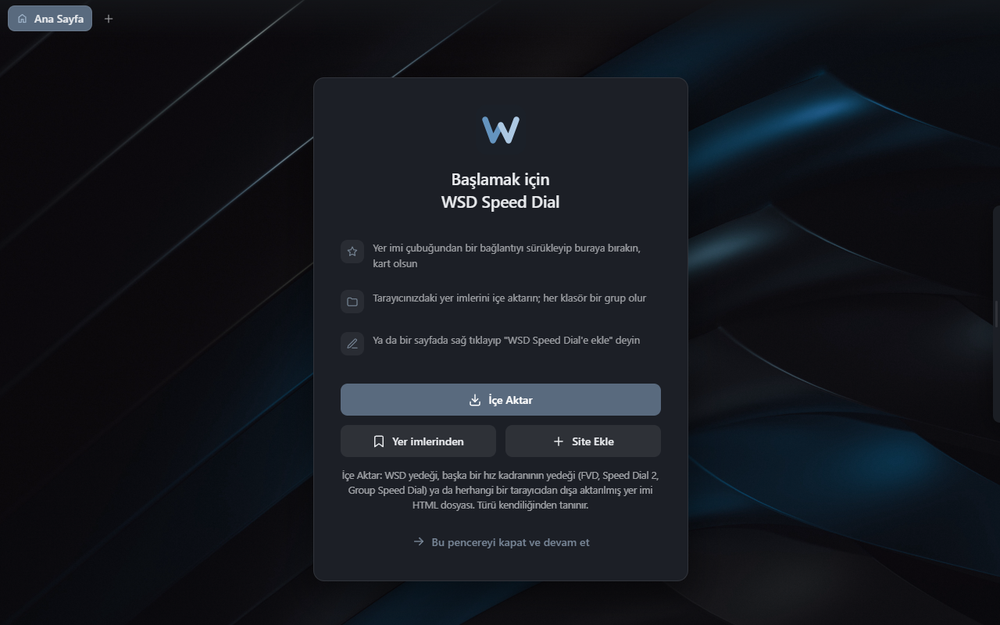
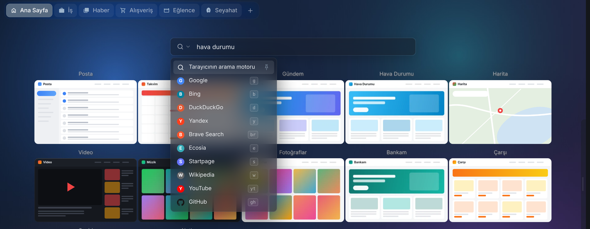
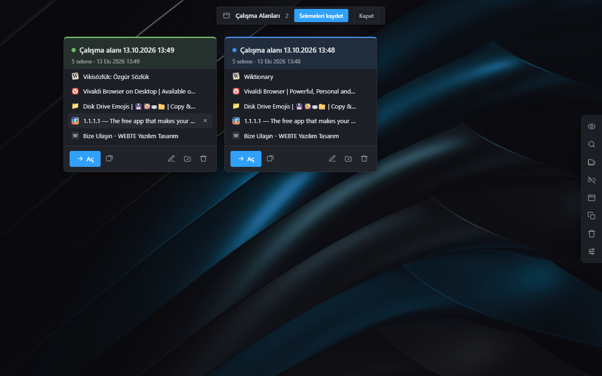

# WSD Speed Dial

Yer imlerinizi görsel kartlar hâlinde gösteren hızlı erişim sayfası.
Chromium tabanlı tarayıcılar için (Chrome, Edge, Vivaldi, Brave, Opera).


---

## Ne yapar

Yeni sekme sayfanızı, sık kullandığınız sitelerin ekran görüntüleriyle
dolu bir panoya çevirir. Kartlar gruplara ayrılır, sürükleyerek sıralanır,
üzerlerine not düşülür.

**Verileriniz tarayıcının kendi yer imlerinde durur.** Ayrı bir veritabanı
yok. Bunun üç faydası var:

- Tarayıcı senkronu bedava gelir — bir cihazda eklediğiniz kart diğerinde belirir
- Veriniz bize kilitlenmez, istediğiniz an yer imi yöneticisinden görürsünüz
- Eklentiyi kaldırsanız bile kartlarınız yer imi olarak kalır

Küçük resimler, notlar ve ayarlar `chrome.storage.local`'da tutulur.

---

## Ekran görüntüleri



| | |
|---|---|
|  |  |
| Ayarlar paneli | Kart düzenleme ve görsel seçimi |
|  |  |
| Tüm gruplarda arama | İlk açılış — içe aktarma ve site ekleme |

---

## Kurulum

1. Paketi bir klasöre açın (ör. `C:\wsd`) — klasör kalıcı olsun, silmeyin
2. `chrome://extensions` adresini açın
3. Sağ üstten **Geliştirici modu**nu açın
4. **Paketlenmemiş öğe yükle** → klasörü seçin

**Güncelleme:** yeni paketi aynı klasörün üzerine açın, ardından eklenti
kartındaki yenile (⟳) simgesine basın. Kaldırıp yeniden yüklemeye gerek yok —
yalnızca izinler değişirse gerekir.

### Vivaldi kullanıyorsanız

Vivaldi yeni sekmede kendi Speed Dial sayfasını açar. Yeni sekmede WSD çıkması için:

**Ayarlar → Sekmeler → Yeni Sekme Sayfası → Uzantı**

### Anasayfa (ev) butonu

Ayarlar → Sistem → **Anasayfa Kurulumu** bölümündeki adresi kopyalayıp tarayıcınızın
başlangıç sayfası ayarına yapıştırın.

---

## Özellikler

### Kartlar

- Sayfa açılınca ekran görüntüsü otomatik yakalanır
- Görsel beğenmediyseniz karuselden başka aday seçin, dosyadan yükleyin
  veya bir görsel adresi verin
- Renk etiketi, not, ziyaret sayacı
- **Adlı etiketler**: Kart Düzenle'de ad + renk ile; bir karta birden çok
  etiket. Aramayı boş açınca renk ve adlı etiketler sayılarıyla listelenir,
  tıklayınca tüm gruplardaki o etiketli kartlar gelir
- Sürükleyerek sıralama, başka gruba taşıma
- Kart üzerine gelince: düzenle, not, yenile, taşı, sil

### Gruplar

- Şeritte sürükleyerek sıralanır
- 22 ikon, özel emoji veya sitenin favicon'u
- Gruba özel gösterim (yalnızca ikon / ikon+yazı / yalnızca yazı) ve ikon rengi
- **Grupları Yönet** ile toplu sıralama, yeniden adlandırma, silme
- **Alt klasörler**: grubun içindeki klasörler ızgarada klasör kutusu olarak
  görünür (ilk dört kartın önizlemesiyle); tıklayınca içine girilir, üstte
  yol şeridi çıkar. Kartı klasör kutusuna ya da yol şeridine sürükleyerek
  taşıyabilirsiniz. Klasör kutusunu başka bir klasörün kenarına bırakınca
  sıralanır, ortasına bırakınca içine girer; grup sekmesine bırakınca o
  gruba taşınır. Klasörler de gruplar gibi düzenlenir: ad, açıklama, ikon,
  ikon rengi, renk etiketi, arka plan rengi ve kapak resmi; not eklenebilir. Üzerine gelince kartlardaki
  gibi araç şeridi çıkar. Klasörler yeniden adlandırılabilir, taşınabilir (üst
  düzey grup da yapılabilir) ve çöp kutusuna silinebilir. Bir grubu başka
  bir grubun içine taşımak için grup menüsünde "Başka gruba taşı"

### Yerel dosyalar

Kartlar yalnızca web sitesi olmak zorunda değil. `file:///` adresleriyle
bilgisayarınızdaki klasörleri, PDF'leri, belgeleri ve resimleri de
kataloglayabilirsiniz — ekran görüntüsü de yakalanır.

Bunun için tarayıcıya izin vermeniz gerekir:

**`chrome://extensions` → WSD Speed Dial → Ayrıntılar →
"Dosya URL'lerine erişime izin ver"**

İzin kapalıyken `file://` kartları açılmaz ve görselleri alınmaz.

---

### Arama

Büyüteç simgesi veya `/` tuşu. Tüm gruplarda arar, sonuçta kartın hangi
gruptan geldiğini yazar. Adı eşleşen grup ve alt klasörler üstte rozet
olarak çıkar; kelime etiket adlarında da aranır. Arama boşken etiket
listesi görünür.

### Web araması

Kartların üstünde motor seçmeli arama kutusu: tarayıcının kendi motoru,
Google, Bing, DuckDuckGo, Yandex, Brave, Ecosia, Startpage, Wikipedia,
YouTube, GitHub. Simgeden yalnızca o arama için motor seçilir; kısayolla
da olur (`g kelime`, `yt kelime`…). Kendi motorunuzu (`%s` içeren adres)
ekleyebilir, listeyi sürükleyip sıralayabilirsiniz. Nerede görüneceği
ayarlanır: yalnızca Ana Sayfa, ilk grup ya da tüm gruplar. Rusça
arayüzde varsayılan Yandex. Yazarken hiçbir yere istek gitmez.



### Görünüm

**Tema:** Koyu / Açık / Sistem modu ve hazır temalar (Gece, Grafit,
Okyanus, Orman, Mor, Gün Batımı, Kontrast; Kâğıt, Kum, Buz, Nane, Pastel,
Mürekkep). Sonra her renk tek tek değişir; kendi temanızı kaydedebilirsiniz.
İsteğe bağlı **buzlu cam** görünüm ve **renkli simgeler**.

Duvar kâğıdı, zemin renklendirme (ton kaydırma veya iki renk), kart oranı,
boyut, çerçeve, sütun sınırı, grup menüsü renkleri. Tek **Köşe
Yuvarlaklığı** ayarı kartları, sekmeleri, menüleri, pencereleri ve
düğmeleri birlikte değiştirir. Yan araç paneli kenara çekilip fare
yaklaşınca açılabilir ya da hep açık durabilir.

Sağdaki göz simgesi her şeyi gizler, yalnızca duvar kâğıdı kalır.

### Çalışma alanları

Bir günlük iş ya da bir proje için açılan sekmeleri saklamak için.
Yan paneldeki düğme ya da araç çubuğundaki simgeye sağ tık →
**Sekmeleri çalışma alanına kaydet**. Kaydederken sekmeler kapanmaz.



- **Aç:** sekmeleri bu pencerede (Vivaldi'de o anki çalışma alanına)
  ya da yeni pencerede açar
- **Düzenle:** ad, etiket, not, renk; kayıtlı sekmeleri çıkarma ve bu
  penceredeki açık sekmelerden ekleme tek pencerede
- **Gruba dönüştür:** kalıcı olacaksa görselli normal grup olur
- Kartlar sürükleyip sıralanır, etiketle süzülür
- Kayıtlar WSD klasörünün yanında **WSD Çalışma Alanları** yer imi
  klasöründe durur; grup şeridi, arama ve görsel yakalama bunlara
  dokunmaz. Yedeğe dahildir.

**Vivaldi / Opera çalışma alanları:** tarayıcı hangi sekmenin hangi
çalışma alanında olduğunu eklentilere bildirmiyor. Pencerede birden
fazla bölüm varsa sekmeler bloklar halinde, işaretsiz listelenir;
blok başlığındaki kutu o bloğun tamamını seçer.

---

## Yedekleme ve taşıma

**Ayarlar → Yedekleme ve Aktarma → Yedek → Yedekle** ile tüm veriniz tek bir
JSON dosyasına iner. Dosya **Yedek adı**nı taşır: `wsd-<ad>-2026-10-20-1457.json`
(ad boşsa tarayıcı adı ve kısa bir cihaz eki).

### Bulut klasörü (deneysel)

**Yedekleme ve Aktarma → Bulut Klasörü**'nden bir klasör seçin — yerel bir
klasör ya da OneDrive / Google Drive / Dropbox klasörü. WSD yedeği
`<klasör>/<yedek adı>/` altına kendisi yazar (günde 1, haftada 1 ya da yalnızca
elle); bulut programı dosyayı yükler. Başka bilgisayarda aynı klasörü seçip
**Klasörden geri yükle** ile listeden tek tıkla yüklersiniz.

- Sunucu, hesap, ek izin yok: tarayıcının dosya erişim özelliği kullanılır.
  Klasör izni tarayıcı yeniden açılınca bir kez onay isteyebilir.
- Her tarayıcı kendi adıyla ayrı alt klasöre yazar; iki bilgisayarda **aynı
  ad** verirseniz ortak yedek setini kullanırlar ve öteki taraftan daha yeni
  yedek gelince haber verilir (kendiliğinden yüklenmez).
- Saklanacak yedek sayısı ayarlanır, eskiler silinir; görseller isteğe bağlı.
- Chrome, Edge, Vivaldi ve Opera'da çalışır; Brave bu özelliği varsayılan
  olarak kapatabilir.

**Yedekten yükle** dört biçimi tanır:

| Kaynak | Taşınan |
|---|---|
| WSD (bu eklenti) | her şey |
| Eski WSD sürümleri | gruplar, kartlar, görseller, notlar, renkler, ayarlar |
| FVD Speed Dial (`fvd-full`) | gruplar, kartlar, görseller |
| FVD Speed Dial (özgün dışa aktarma) | gruplar, kartlar, tıklama sayıları |

FVD'nin özgün yedeğinde görseller taşınamaz: dosya yolu olarak saklandıkları
için başka bir eklenti onlara erişemez. Kartlar eklenir, görselleri yeniden
yakalanır.

FVD yedeğini dosya olarak değil, ayarlarındaki bir metin kutusunda verir.
O metni kopyalayıp **Ayarlar › Yedekleme › Metin yapıştır** ile doğrudan
içe aktarabilirsiniz; dosyaya kaydetmeye gerek yoktur.

Speed Dial 2, Speed Dial ve Group Speed Dial yedeklerinden gruplar ve
kartlar aktarılır; görselleri o eklentilerin sunucularında durduğu için
WSD'de yeniden yakalanır.

**Speed Dial (`.spd`)** yedeğinde logolar gömülü geldiği için kartlar
görselleriyle aktarılır; arama motoru tercihi de alınır. 30'dan fazla
kartın görseli eksikse (FVD gibi) WSD yakalamayı sormadan başlatmaz:
"Arka planda al" ya da "Şimdi değil".

### Hazır gruplar

Karşılama ekranındaki ya da **Yedekleme › İçe Aktar**'daki **Hazır
Gruplar** düğmesi, dile göre örnek paketleri listeler (Günlük, Alışveriş,
Geliştirici…). Paketler bu depodaki [`paketler/`](paketler/) klasöründe;
yeni paket önerileri çekme isteğiyle gelebilir.

Birden fazla tarayıcıdaki veriyi birleştirmek için: ilkinde **"Sil ve yükle"**,
sonrakilerde **"Ekle"** seçin.

### Çöp kutusu

Silinen kartlar 30 gün saklanır. Bildirimdeki **Geri Al** düğmesini
kaçırdıysanız boş alan menüsünden **Çöp Kutusu**'na girin.

---

## Ayarlar

Panelin en üstündeki **Ayar ara** kutusu eşleşen ayarları süzer ve ilgili
bölümleri açar. Her bölüm açılır alt bölümlerden oluşur:

| Bölüm | Alt bölümler |
|---|---|
| Görünüm | Tema · Arka Plan · Grup Menüsü · Yazı ve Panel · Arayüz |
| Ana Sayfa | Davranış · Arama Çubuğu · Anasayfa Kurulumu |
| Kartlar | Davranış · Boyut ve Yerleşim · Başlık · Renk ve Çerçeve |
| Görüntü Yakalama | Yakalama · Gelişmiş · Görüntü |
| Yedekleme ve Aktarma | Yedek · Bulut Klasörü · İçe Aktar |
| Sistem | Uzantı Simgesi · Sağ Tık Menüsü · Kısayollar · Bakım · Sıfırlama |
| Hakkında | sürüm, Yenilikler, değerlendir, öneri / hata bildir |

Panel son açık bölümü hatırlar.

### Görüntü yakalama kipleri

**Pencere** (Chrome'da varsayılan) — sayfa küçük bir pencerede açılır, kısa
süre görünür. "Küçük pencere, köşede" seçeneğiyle yarı boyutta ve sağ alt
köşede açılır.

**Gizli** (Edge, Vivaldi ve diğerlerinde varsayılan) — sekme arka planda
açılır, pencere hiç görünmez. Chrome bu kipte üstte "hata ayıklıyor"
çubuğu gösterir; diğer tarayıcılar sessizdir.
Bu kip `debugger` iznini kullanır. Chrome bu iznin isteğe bağlı
olmasına izin vermediği için kurulumda istenir.

---

## Klavye

| Tuş | İşlev |
|---|---|
| `1` – `9` | o sıradaki gruba geç |
| `Home` / `End` | ilk / son grup |
| `←` / `→`, `-` / `+`, `PageUp` / `PageDown` | önceki / sonraki grup |
| `/` veya `Ctrl+F` | arama |
| `H` | her şeyi gizle / göster |
| `Ctrl+,` | ayarları aç / kapat |
| `N` | yeni kart |
| `G` | yeni grup |
| `Y` | grupları yönet |
| `Backspace` | alt klasördeyken bir üst klasöre çık |
| Fare yan tuşları / `Alt+←` `Alt+→` | klasör ve gruplar arasında geri / ileri |
| `Esc` | pencereyi/aramayı kapat |
| `Enter` (aramada) | ilk sonucu aç |

Kısayollar bir metin alanındayken ya da açık pencere varken çalışmaz.

---

## Bilinen sınırlar

- **Yakalama penceresi bir an görünür.** Tarayıcı yalnızca görünür sekmeyi
  yakalamaya izin verdiği için kaçınılmaz. "Gizli" kipi bunu çözer ama
  hata ayıklama çubuğu getirir.
- **Toplu yenileme uzun sürer.** Kart başına birkaç saniye. Kuyruk arka planda
  ilerler; tarayıcı kapansa bile kaldığı yerden devam eder.
- **`chrome://` sayfalarında** sağ tık menüsü ve bildirimler çalışmaz —
  tarayıcı bu sayfalarda eklenti betiği çalıştırmaz.

---

## Geliştirme

Bağımlılık yok, derleme adımı yok. Dosyaları düzenleyip eklentiyi yenilemek
yeterli.

```
manifest.json      MV3 tanımı
index.html         yeni sekme sayfası
css/wsd.css        tasarım sistemi (değişkenler, bileşenler)
js/
  wsd.js           giriş noktası
  arkaplan.js      servis işçisi — menüler, simge, mesajlar
  yerimi.js        yer imi katmanı (gruplar, kartlar)
  cizim.js         grup şeridi ve kart ızgarası
  etkilesim.js     menüler, pencereler, kart işlemleri
  ayar.js          ayar deposu ve varsayılanlar
  ayarpanel.js     ayarlar paneli
  yakalama.js      ekran görüntüsü kuyruğu
  gorsel.js        görsel deposu ve küçültme
  arama.js         kart araması
  webarama.js      web arama kutusu ve motorlar
  tema.js          açık/koyu mod ve hazır temalar
  renksecici.js    ayar panelindeki renk seçici
  paketler.js      hazır gruplar
  kartsurukle.js   kart sürükleme motoru
  grupsurukle.js   grup şeridi sürükleme
  yedek.js         yedekleme, içe aktarma, temizlik
  cop.js           çöp kutusu
  ...
```

CSS'te renk, boşluk ve köşe değerleri `:root` altındaki değişkenlerden gelir.
Yeni bileşen eklerken sabit değer yazmak yerine bunları kullanın.

---

## Katkı

Çeviri katkısı özellikle değerli — arayüz Türkçe, İngilizce ve Rusça tam; diğer diller kısmi.

Ayrıntılar için `CONTRIBUTING.md` dosyasına bakın.

---

## Gizlilik

Hiçbir veri toplanmaz, iletilmez veya paylaşılmaz. Ayrıntılar için
`PRIVACY.md` dosyasına bakın.

---

## Lisans

**GNU General Public License v3.0** — bkz. `LICENSE`.

Kısaca: kullanabilir, inceleyebilir, değiştirebilir ve dağıtabilirsiniz.
Değiştirip dağıtırsanız kaynağı da aynı lisansla açmanız gerekir.

Bu proje, kaynağı kapalı bir eklentiyi temel alamadığı için sıfırdan
yazıldı. Aynı durumun tekrarlanmaması adına GPL seçildi.

Kullanılan üçüncü taraf kod yoktur — tüm kaynak sıfırdan yazılmıştır.

Copyright (C) 2026 muttixp
